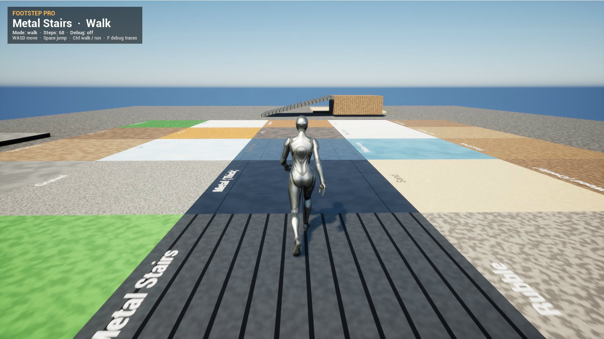
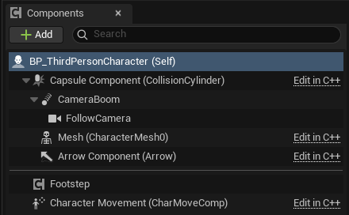
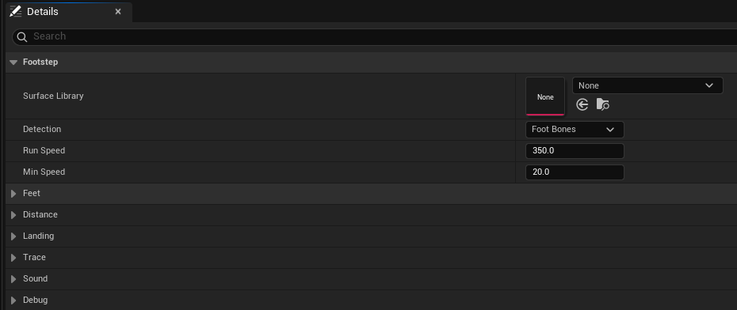
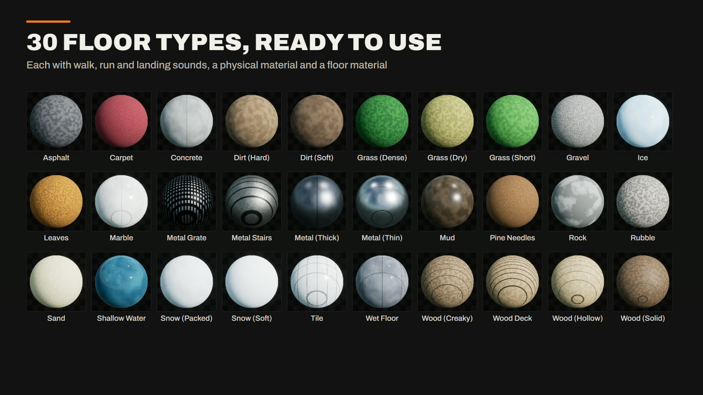
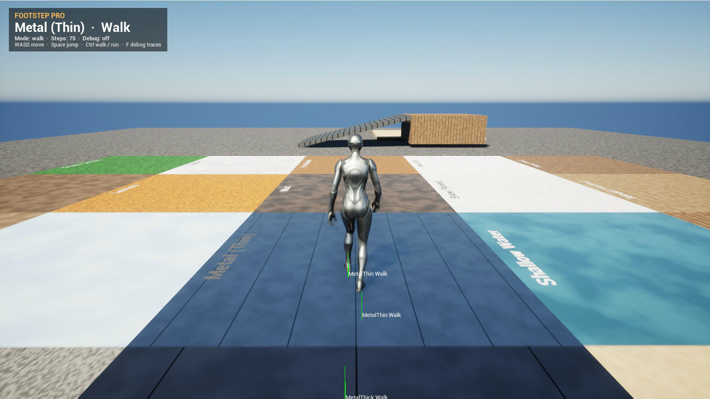

# Footstep Pro for Unreal Engine

> This repository holds the documentation and the example project of **Footstep Pro**, a footstep plugin with 30 surfaces sold on Fab. The plugin and its sounds are not included here; get them from Fab. The example project is under [Releases](https://github.com/rohyunsang/FootstepPro/releases/latest).

Surface-aware footsteps for any character. Add the **Footstep** component and the character plays walk, run and landing sounds that match the floor under each foot. It ships with 30 surfaces (90 sounds), their physical materials and ready-made floor materials. Steps are read from the animation's foot bones, so you need no anim notifies and no code.

- **Engine versions:** Unreal Engine 5.5, 5.6, 5.7, 5.8
- **Platform:** Windows (Win64)
- **Audio:** 90 sounds (30 surfaces × walk / run / land), mono, 44.1 kHz
- **Module:** `FootstepPro` (Runtime)
- **Manual (PDF):** `Docs/FootstepPro_Manual.pdf`
- **Online documentation:** https://github.com/rohyunsang/FootstepPro
- **Example project:** https://github.com/rohyunsang/FootstepPro/releases/latest/download/FootstepPro_ExampleProject.zip

## Contents

1. [Installation](#installation)
2. [Quick start](#quick-start)
3. [Example project](#example-project)
4. [What is included](#what-is-included)
5. [How a surface is chosen](#how-a-surface-is-chosen)
6. [Step detection](#step-detection)
7. [Component settings](#component-settings)
8. [Using your own floors and sounds](#using-your-own-floors-and-sounds)
9. [Blueprint API](#blueprint-api)
10. [Debugging](#debugging)
11. [FAQ](#faq)
12. [Support](#support)

## Installation

1. Install **Footstep Pro** from Fab into your engine (Fab > Library > Install to Engine).
2. Open your project and enable the plugin in **Edit > Plugins** (search "Footstep Pro"), then restart the editor.
3. The content appears in the Content Browser under **Plugins > Footstep Pro Content**. If you don't see it, turn on **Settings > Show Plugin Content** in the Content Browser.

## Quick start

1. Open your character Blueprint and click **Add > Footstep**.

   

2. Give your floors a footstep material. Either use one of the `MI_Floor_*` materials in **Footstep Pro Content > Materials > Floors**, or set the **Phys Material** of your own material to one of the `PM_Foot_*` physical materials.
3. Press **Play** and walk. Steps switch to run sounds above **Run Speed**, and a landing plays after a fall.

The default settings fit the UE5 Manny/Quinn skeleton (`foot_l`, `foot_r`). For other skeletons, set **Foot Bones** to your feet's bone names.

## Example project

The example project opens on a map with all 30 floors, a metal ramp up to a wooden deck, and a sand pit to jump into. The panel at the top left shows the surface under the character and the step type.

1. Install the plugin from Fab (see Installation).
2. Download [FootstepPro_ExampleProject.zip](https://github.com/rohyunsang/FootstepPro/releases/latest/download/FootstepPro_ExampleProject.zip), unzip it and open `FootstepPro.uproject` with UE 5.5 or later.
3. Press **Play**. Use **WASD** to move and **Space** to jump. **Ctrl** switches between walking and running, and **F** shows the debug traces.

The **Footstep Demo HUD** actor in the map is only for the demo. You don't need it in your game.

## What is included

| Surfaces | |
|---|---|
| Hard | Asphalt, Concrete, Marble, Tile, Rock, Rubble, Wet Floor |
| Soft | Carpet, Dirt (Hard), Dirt (Soft), Mud, Sand, Gravel |
| Nature | Grass (Short), Grass (Dense), Grass (Dry), Leaves, Pine Needles, Snow (Soft), Snow (Packed), Ice, Shallow Water |
| Metal | Metal Grate, Metal Stairs, Metal (Thick), Metal (Thin) |
| Wood | Wood (Solid), Wood (Hollow), Wood (Creaky), Wood Deck |

In **Footstep Pro Content**:

| Folder | Content |
|---|---|
| `Sounds/<Surface>` | `SW_Foot_<Surface>_Walk`, `_Run`, `_Land` (90 sounds) |
| `PhysicalMaterials` | `PM_Foot_<Surface>`: one Footstep Physical Material per surface (30) |
| `Materials` | `M_FootstepFloor`: the floor master material (color, noise, planks/tiles, grout) |
| `Materials/Floors` | `MI_Floor_<Surface>`: a floor material per surface, with its physical material set (30) |
| `Data` | `DA_FootstepSurfaces`: the surface library; `ATT_Footsteps`: attenuation (full volume within 2 m, silent after 20 m) |

## How a surface is chosen

For every step, the component traces down from the foot and reads the physical material of what it hits. It then picks the first match in this list:

1. **Footstep Physical Material:** the material's **Footstep Surface** name (all `PM_Foot_*` work this way).
2. **Physical material listed in the library:** any physical material you add to a surface's **Physical Materials** list. Use this for materials you already have.
3. **Surface type:** the project's Physical Surface types (Project Settings > Physics > Physical Surface) that you add to a surface's **Surface Types** list.
4. **Default surface:** the library's **Default Surface** (Concrete).

Landscapes work the same way. Set the physical material on each landscape layer (in the layer info or the landscape material).

## Step detection

| Detection | How it works | Use it when |
|---|---|---|
| **Foot Bones** (default) | Watches each foot bone. A step plays when a foot comes back down after clearly lifting off. | Any walk or run animation; nothing to set up |
| **Anim Notify** | Steps play only from **Footstep** notifies in your animations. | You want exact, hand-placed timing |
| **Distance** | A step every half stride (**Walk Stride**, **Run Stride**) while moving on the ground. | Characters without legs, cameras, vehicles |

**Anim Notify:** in an animation sequence, right-click a notify track > **Add Notify > Footstep**. Set **Foot Bone** to the foot touching down. **Type** is Auto by default, which picks walk or run from the speed; it can also be forced to Walk, Run or Land. In the animation editor the notify previews the default surface's sound.

## Component settings

| Setting | Default | |
|---|---|---|
| Surface Library | (plugin's) | Floors and sounds. Empty uses `DA_FootstepSurfaces`. |
| Detection | Foot Bones | See [Step detection](#step-detection). |
| Run Speed | 350 | Ground speed (cm/s) from which run sounds play. |
| Min Speed | 20 | No steps below this speed. |
| Feet › Foot Bones | foot_l, foot_r | Bones or sockets of the feet. |
| Feet › Foot Lift Height | 8 | A foot is in the air once it is this many cm above its planted height. Raise it if steps double up; lower it for shuffling or crouched walks. |
| Feet › Foot Contact Height | 4 | A foot in the air touches down when it comes back within this many cm of its planted height. |
| Distance › Walk / Run Stride | 140 / 220 | cm per two steps (Distance detection). |
| Landing › Play Landing | on | Landing sound after a fall. |
| Landing › Min Landing Speed | 250 | Falling speed (cm/s) needed. Small hops stay quiet. |
| Trace › Trace Distance | 60 | How far below the foot to look for the floor (cm). |
| Trace › Trace Channel | Visibility | Collision channel of the floor trace. |
| Sound › Volume | 1.0 | Multiplied with the surface's own volume. |
| Sound › Pitch Variation | 0.06 | Random pitch of ±6 % per step. |
| Sound › Volume Variation | 0.15 | Each step up to 15 % quieter, at random. |
| Sound › Attenuation | (plugin's) | Empty uses `ATT_Footsteps`. |
| Sound › Concurrency | none | Optional Sound Concurrency, for example to limit steps from crowds. |
| Debug › Draw Debug | off | Draws each floor trace and the surface name. |

## Using your own floors and sounds

**Your own floor:** set your material's **Phys Material** (Material > Details > Physical Material) to a `PM_Foot_*`. For a mesh, you can instead set **Phys Material Override** in its collision settings.

**A new surface:**
1. Duplicate `DA_FootstepSurfaces` (or create a **Footstep Surface Library** data asset), then set it as the component's **Surface Library**.
2. Add an element to **Surfaces**. Give it a **Surface** name (for example `Metal_Vent`) and add sounds to **Walk**, **Run** and **Land**. A list with several sounds plays them at random without immediate repeats. An empty Land list falls back to Run, and an empty Run list to Walk.
3. Create a physical material of class **Footstep Physical Material**, set its **Footstep Surface** to `Metal_Vent`, and use it on your floor.

## Blueprint API

| Node | |
|---|---|
| **On Footstep** (event) | Every step and landing: Surface, Type (Walk / Run / Land), Location, Physical Material. Use it for dust, decals or AI noise. |
| **Play Footstep** | Plays a step of a given type now, optionally under a foot bone. |
| **Play Footstep Auto** | Plays a walk or run step for the current speed. |
| **Get Surface At** | The surface (and physical material) under a world location. |
| **Get Last Surface** | Surface of the most recent step. |
| **Get Movement Type** | Walk or Run for the current speed. |
| **Resolve Surface** (library) | The surface name for a physical material. |
| **Get Surface Names** (library) | All surface names in a library. |

## Debugging

| Console command | |
|---|---|
| `Footstep.Debug 1` | Draws every step's floor trace with the surface name, for all characters. |
| `Footstep.Log 1` | Logs every step: `[Footstep] <time> <surface> <type> <sound>`. |
| `Footstep.LogFeet 1` | Logs the foot bone heights every frame, for tuning Foot Lift / Contact Height. |

## FAQ

**No sounds play.** Check that the character's mesh has the foot bones listed in **Foot Bones**, and that the floor blocks the **Trace Channel** (Visibility by default). Then run `Footstep.Debug 1`: a trace that hits nothing draws red.

**Every floor sounds like concrete.** The floor's material has no footstep physical material, so the default surface plays. Set its Phys Material (see [Using your own floors and sounds](#using-your-own-floors-and-sounds)).

**Steps play twice, or some are missing.** Your animation lifts the feet more or less than Manny. Raise **Foot Lift Height** if steps double, or lower it if steps are missing. `Footstep.LogFeet 1` shows the real heights. You can also switch to **Anim Notify** detection.

**Does it work in multiplayer?** Each client plays the steps of the characters it sees, from their animation. Nothing is replicated or needed on the server.

**Can I use it on AI and other characters?** Yes. Add the component to any Character (or any actor with a skeletal mesh). Use a Sound Concurrency to cap crowds.

## Support

- Email: llog@llog.dev
- Documentation and updates: https://github.com/rohyunsang/FootstepPro
